# Space Compass

[](https://github.com/mondiversi/SpaceCompass/actions/workflows/android.yml)

Space Compass is an Android sky compass for the Sun, Moon, planets, satellites,
stars and other celestial objects. Point your phone or tablet, explore daily
paths, inspect reference facts and view textured models. Space Compass is a standalone application.

## Download and install

Download **space-compass-1.9.1.apk** from the
[Space Compass 1.9.1 release](https://github.com/mondiversi/SpaceCompass/releases/tag/v1.9.1).
Android 8.0 or newer is required. Open the APK and follow Android's installation
prompts; allow installation for your browser or file manager if requested.

Install over the existing app to retain settings and selections. **Do not uninstall
or clear app data when updating.** Releases since 0.1.2 check for signed GitHub
updates at startup; you can also use **Info & credits → GitHub repository → Check for
updates**. Download and installation require confirmation. Version 0.1.0 needs
one manual APK update to acquire this feature.

The release includes `SHA256SUMS.txt` and a signed update index. GitHub's source
ZIP/TAR archives and Actions debug artifacts are separate from the signed APK.
See [distribution and signing](docs/GITHUB_RELEASES.md) for verification details.

<!-- app-gallery:start -->
## Gallery

See Space Compass in portrait and landscape, by day and by night. These English screenshots use a public London demonstration, without personal location data. Select an image to view it at full size.

<table>
  <tr>
    <td align="center">
      <a href="docs/screenshots/full/01-day-sky-portrait.webp">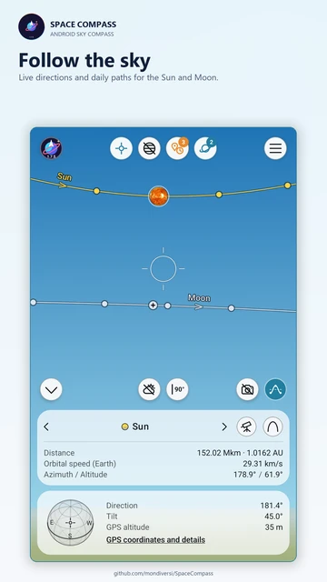</a><br>
      <sub>Daylight sky</sub>
    </td>
    <td align="center">
      <a href="docs/screenshots/full/02-night-sky-portrait.webp">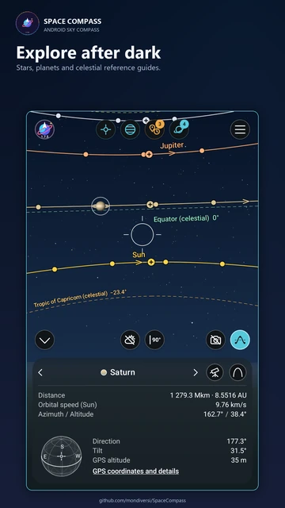</a><br>
      <sub>Night sky</sub>
    </td>
    <td align="center">
      <a href="docs/screenshots/full/03-observatory-portrait.webp">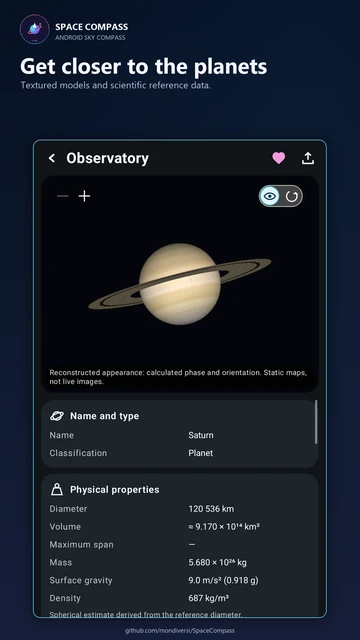</a><br>
      <sub>Saturn Observatory</sub>
    </td>
  </tr>
  <tr>
    <td align="center">
      <a href="docs/screenshots/full/04-daily-path-portrait.webp">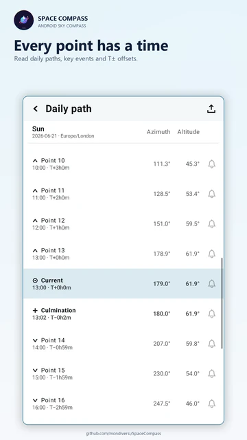</a><br>
      <sub>Daily path</sub>
    </td>
    <td align="center">
      <a href="docs/screenshots/full/05-catalogue-portrait.webp">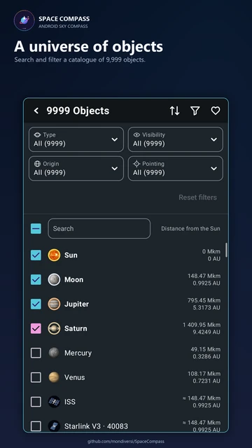</a><br>
      <sub>Catalogue and filters</sub>
    </td>
    <td align="center">
      <a href="docs/screenshots/full/06-location-portrait.webp">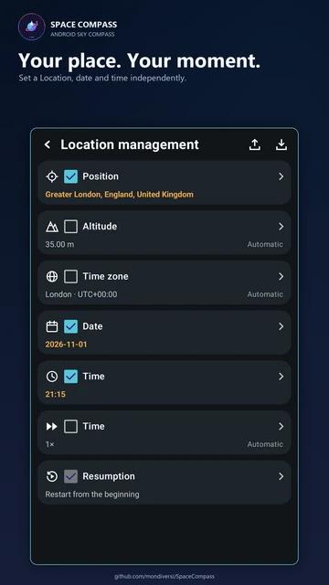</a><br>
      <sub>Location management</sub>
    </td>
  </tr>
  <tr>
    <td align="center">
      <a href="docs/screenshots/full/07-key-heights-portrait.webp">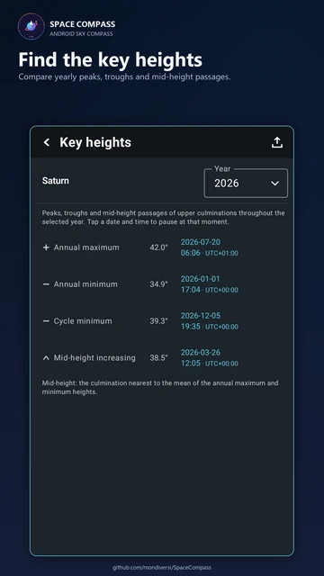</a><br>
      <sub>Key heights</sub>
    </td>
    <td align="center">
      <a href="docs/screenshots/full/08-key-events-portrait.webp">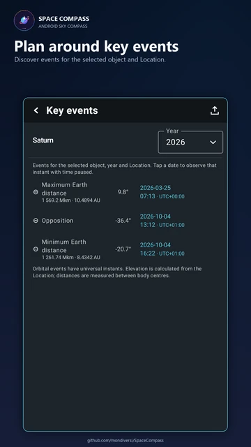</a><br>
      <sub>Key events</sub>
    </td>
    <td align="center">
      <a href="docs/screenshots/full/12-export-portrait.webp">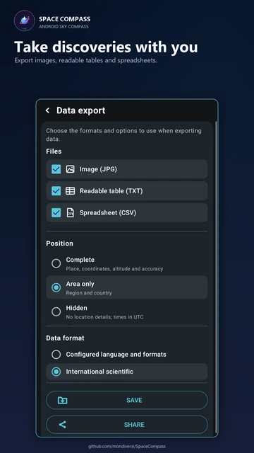</a><br>
      <sub>Data export</sub>
    </td>
  </tr>
  <tr>
    <td align="center">
      <a href="docs/screenshots/full/13-general-portrait.webp">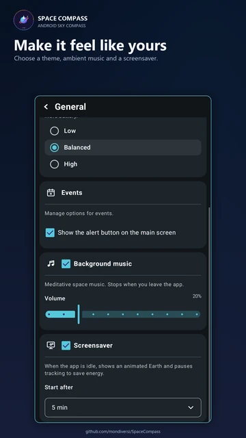</a><br>
      <sub>General settings</sub>
    </td>
    <td align="center">
      <a href="docs/screenshots/full/15-globe-day-portrait.webp">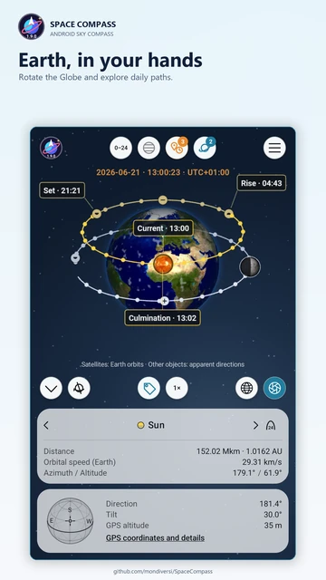</a><br>
      <sub>Interactive Globe</sub>
    </td>
    <td align="center">
      <a href="docs/screenshots/full/16-globe-labels-portrait.webp">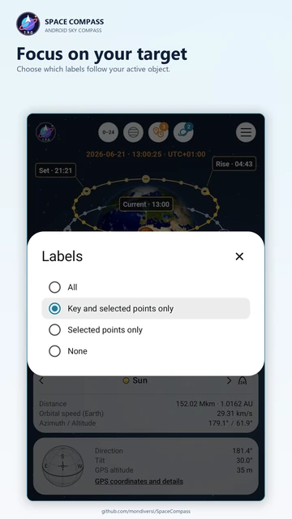</a><br>
      <sub>Globe label options</sub>
    </td>
  </tr>
  <tr>
    <td align="center">
      <a href="docs/screenshots/full/17-tutorial-globe-portrait.webp">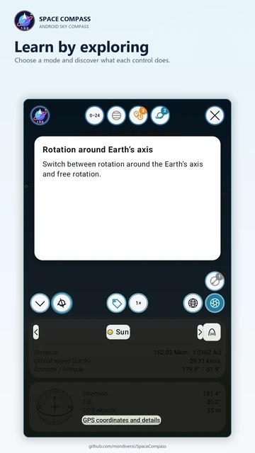</a><br>
      <sub>Interactive tutorial</sub>
    </td>
  </tr>
</table>

<table>
  <tr>
    <td align="center">
      <a href="docs/screenshots/full/09-observatory-landscape.webp">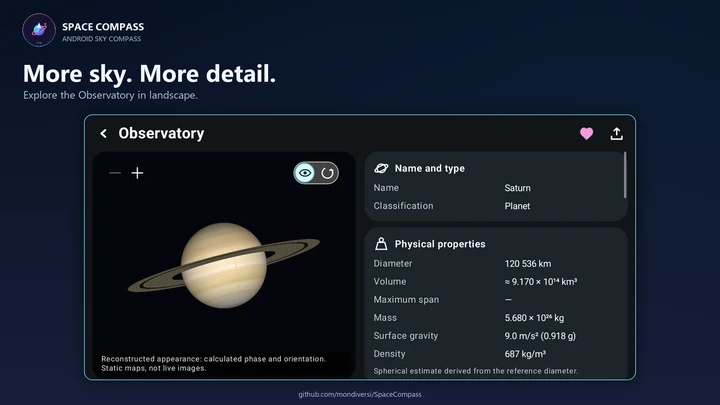</a><br>
      <sub>Landscape Observatory</sub>
    </td>
    <td align="center">
      <a href="docs/screenshots/full/10-sunrise-landscape.webp">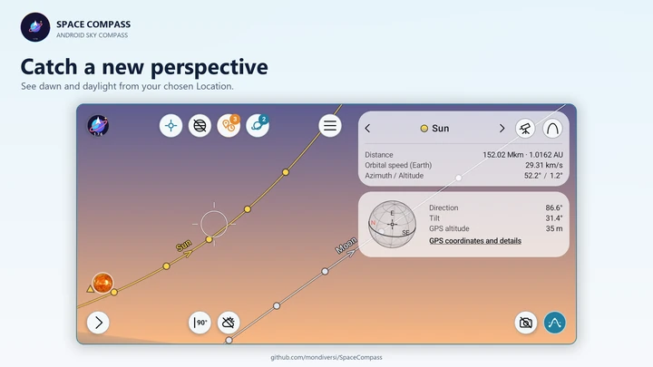</a><br>
      <sub>Dawn in landscape</sub>
    </td>
  </tr>
  <tr>
    <td align="center">
      <a href="docs/screenshots/full/11-panorama-landscape.webp">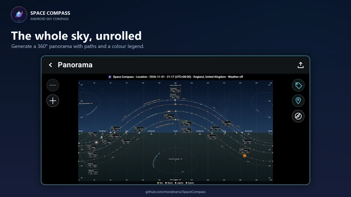</a><br>
      <sub>Full-sky panorama</sub>
    </td>
    <td align="center">
      <a href="docs/screenshots/full/14-daily-path-landscape.webp">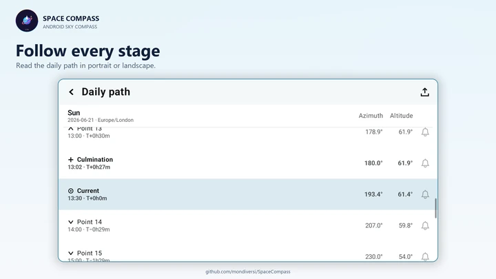</a><br>
      <sub>Landscape daily path</sub>
    </td>
  </tr>
  <tr>
    <td align="center">
      <a href="docs/screenshots/full/18-globe-night-landscape.webp">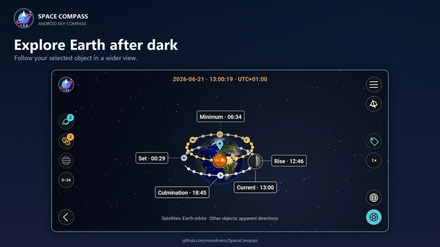</a><br>
      <sub>Globe in landscape</sub>
    </td>
    <td align="center">
      <a href="docs/screenshots/full/19-globe-capture-landscape.webp">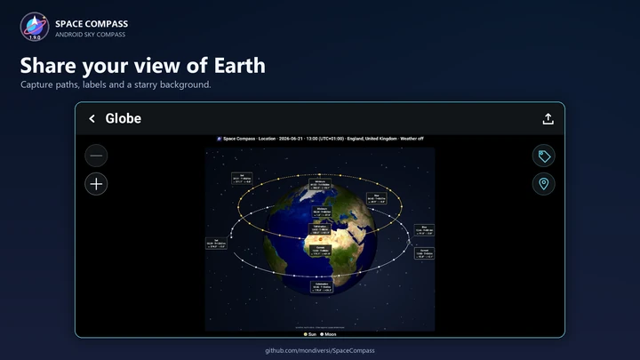</a><br>
      <sub>Landscape Globe capture</sub>
    </td>
  </tr>
  <tr>
    <td align="center">
      <a href="docs/screenshots/full/20-view-modes-landscape.webp">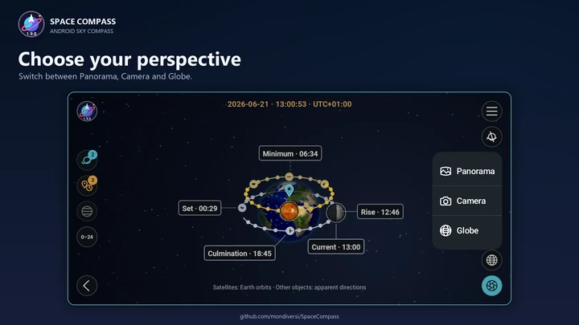</a><br>
      <sub>Three viewing modes</sub>
    </td>
  </tr>
</table>

[Explore all 20 screenshots and unframed app captures](docs/screenshots/README.md).

<!-- app-gallery:end -->

## Features

- **Find objects in the sky.** Point your phone to see where the Sun, Moon, planets and other objects are, including those below the horizon.
- **See the sky through your camera.** Overlay objects and their paths on your surroundings. Zoom in or out and fade the object images to compare their predicted positions with what you see. The live grid adapts its contrast to the background.
- **Control the view with a tap.** Tap empty sky to pause or resume sky time; double-tap to show or hide the reticle and controls. Double-tap a photo or panorama preview to toggle its overlay controls.
- **Choose your field of view.** Adjust and remember virtual-sky zoom from 0.5× to 1×, with separate camera zoom for the lenses available on your device.
- **Explore an interactive Earth.** Switch to Globe, rotate around Earth’s axis or freely, inspect paths and key points, and generate a Globe image. Choose which labels follow the object selected in the island. Earth satellites use Earth-centred orbits; distant objects show apparent directions.
- **Follow daily paths.** See when an object rises, reaches its highest point and sets. Choose today's full path or the next 24 hours, select points of interest and check how long until they happen.
- **Explore other places and times.** Create a Location with a different place, date or time. Pause, speed up or reverse time by up to fifteen days per second. Set up changes at your own pace and apply them when you return to the sky, then save or share the place and time settings independently.
- **Plan your observations.** Compare the current sky with dated paths from Key Heights, Key Events or your own Personal Moments. Save or share Personal Moments separately, or include active comparisons when exporting a Scene. Future path points can also be sent to Android's Clock or Calendar.
- **Capture the view.** Take a camera photo with celestial overlays, capture the visible Sky or Globe, or generate a complete panorama. Export the frame, panorama or both; choose grids and labels and use the colour legend to identify each object's path.
- **Share your sky setup.** Export a Scene with selected objects, dated comparisons, orbit points and Antipodes. Include Location when needed, and choose whether automatic place and time values should be fixed at export. Load it to restore the view.
- **Save and share your findings.** Export images, CSV spreadsheets and readable tables from captures, daily paths and the Observatory. Choose your language and units or international formatting, and control how much location information to include.
- **Browse 9,999 objects.** Discover planets, moons, stars, constellations, galaxies, spacecraft and more. Search, filter and sort the catalogue, mark favourites and choose what appears in your sky.
- **Take a closer look in the Observatory.** Explore images and interactive models, lunar phases, object facts and spatial context. Compare estimated travel times at different speeds, from walking to light speed and fictional warp speeds.
- **Add reference points.** Show celestial guide lines, the poles, zenith and nadir, or display the opposite directions of your selected points with Antipodes.
- **Make it comfortable to use.** Choose light or dark mode, your preferred units and one of twenty interface languages. Follow the built-in tutorial, adjust sky smoothness, enjoy optional ambient music or relax with the animated Earth screensaver, which pauses live tracking while active. Drag the globe to explore; after ten idle seconds it returns smoothly to its normal rotation. Double-tap to return to the app.

Sun, Moon and major-planet calculations work offline, and downloaded images stay
available on your device. Weather, satellites and some other objects need online
data. Supported events and available predictions depend on the object and date.

Scientific facts carry their qualifications and source notices. Unavailable data
are not replaced with invented values. This is a sky visualization and not a
safety or navigation instrument.

## Build and checks

The application ID is `me.mondiversi.spacecompass`. This source builds version
**1.9.1**, with Android/update identity `1.9.1` and version code **77**.
This preserves the three-part update protocol used by existing preview installations.
The app stores its preferences and caches privately.

Open in Android Studio. Install Android SDK Platform 37.0 and Build Tools 36.0.0.
The local build uses the bundled Android Studio JDK 25; CI uses Temurin 25.
Gradle is pinned to 9.5.0, Android Gradle Plugin to 9.3.1 and the Compose compiler
to 2.2.10. The first build needs internet access.

```sh
./gradlew :app:assembleDebug :app:testDebugUnitTest :app:compileDebugAndroidTestKotlin :app:assembleRelease :app:lintRelease
```

On Windows use `gradlew.bat`. Debug APKs are written to `app/build/outputs/apk/debug/`.
Release builds enable R8 code and resource optimization. GitHub Actions runs these
checks without the distribution key and retains debug/test reports. Instrumentation
sources are compiled; execution requires separate device/emulator authorization.
Release APKs are aligned and signed locally. Private keys, credentials and local SDK
paths are excluded from the repository and never stored in GitHub Actions.

## Permissions and online data

Location is requested for observer-dependent calculations. Camera access is requested
only when camera mode is enabled. Location/orientation/camera resources follow the
foreground lifecycle. The app has no background location, advertising or analytics.
Android 8/9 asks for legacy storage write access only for an explicit gallery save.
The app never reads other apps' photographs. Update installation uses Android's
installer permission and always requires the user's confirmation.

Sun, Moon and major-planet calculations run locally. Satellite elements and
JPL Horizons ephemerides use bounded HTTPS requests and app-private caches. Catalog
data refresh silently every ten minutes and when models or observer settings change. Network failure does
not disable valid offline calculations. Unavailable/expired data remain explicit.

Open-Meteo weather uses rounded coordinates. Position details use Android's geocoder,
which may contact its configured service. Maps request OpenStreetMap tiles; night maps
are styled in the app. User-initiated Location lookups may contact the documented
location/elevation/time-zone providers. These lookups are foreground-only; street
addresses, place names and observer coordinates are excluded from error logs.
See [scenario provider details](docs/OBSERVATION_SIMULATION.md). Review provider terms
before commercial distribution, including the free Open-Meteo endpoint.

## Documentation and license

- [Architecture](ARCHITECTURE.md), [presentation](docs/APP_PRESENTATION.md) and [verification](docs/VERIFICATION.md).
- [Celestial models](docs/CELESTIAL_VIEWER.md), [deep-sky data](docs/DEEP_SKY.md) and [reference data](docs/REFERENCE_DATA_AUDIT.md).
- [Panorama/export](docs/PANORAMA_CAPTURE.md), [camera](docs/CAMERA_VIEW.md), [catalog search](docs/CATALOG_SEARCH.md) and [curved reference labels](docs/CURVED_REFERENCE_LABELS.md).
- [Assets and third-party credits](ASSET_CREDITS.md).

Copyright © 2026 Mondiversi. Application code is licensed under [GPL-3.0](LICENSE).
Third-party SGP4 code and image maps retain their respective licenses/credits;
Astronomy Engine uses MIT, AndroidX uses Apache-2.0 and Leaflet uses BSD-2-Clause.
Launcher/loading artwork and original illustrations are project assets.

Capture the visible frame in **Sky** or **Globe**, or switch to a complete panorama (a flat map for Globe). Export either image or both together, alongside tables frozen at capture time. Capture grids and labels remain configurable. Live Sky/Camera grids adapt their light/dark contrast to the background, with a two-tone fallback on Android 8/9. See [capture projections](docs/CAPTURE_PROJECTIONS.md).

## Data and graphics packages

Release 1.9.1 includes **9,999 selectable objects**, and an optional reference-information archive.
All descriptive data and translations remain inside the APK. Scientific limits and provenance are in the
[catalogue sources](docs/CATALOG_9999.md) and [canonical source catalogue](catalogue/README.md).

The [graphics collection 1.8](https://github.com/mondiversi/SpaceCompass/releases/tag/celestial-textures-v1.8)
contains **189 full images and 189 independent 128×128 previews**, all WebP quality 90/method 6.
Most full images are 2048×1024; existing illustrations retain their original source dimensions.
Catalogue/live/captured glyphs request lightweight previews. The Observatory and image exports
fetch full resources when needed; lunar phase stays dynamic.
The complete logical image collection is **43.66 MB (41.64 MiB; 43,663,574 bytes)**, excluding metadata.
The incremental 1.8 release adds five photographs and five previews: **444,858 image bytes**, plus index, credits and checksums. Unchanged files continue to download from immutable packs 1.6 and 1.7;
the manifest and APK pin every resource to its exact version, size, SHA-256 and dimensions.
Downloads are individual, with persistent offline caches and reusable verified legacy filenames.
Missing photographs keep appropriate rendered symbols without disabling pointing.
The APK contains scientific data, all twenty languages, the star atlas and separate Earth screensaver maps,
without celestial photographs or complete texture ZIPs. Older releases and their resource URLs remain available.
