# Space Compass gallery

Explore the live sky, the Observatory, daily paths, Locations and export tools. Select any image to open the full-size presentation card.

## Portrait

<table>
  <tr>
    <td align="center">
      <a href="full/01-day-sky-portrait.webp">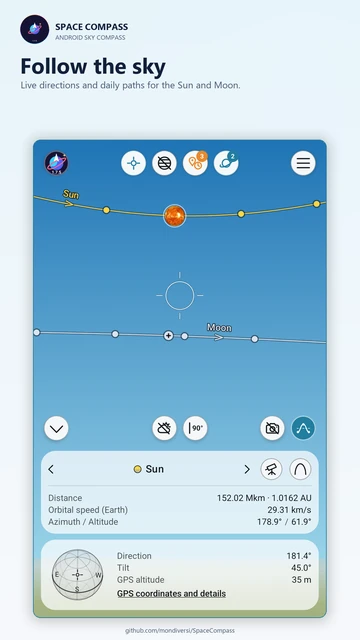</a> 
      Daylight sky
    </td>
    <td align="center">
      <a href="full/02-night-sky-portrait.webp">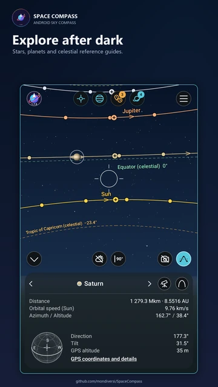</a> 
      Night sky
    </td>
    <td align="center">
      <a href="full/03-observatory-portrait.webp">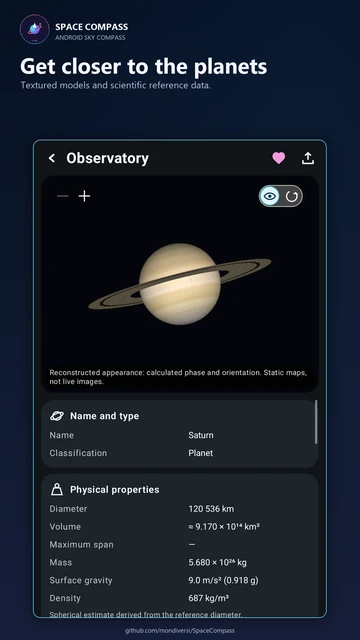</a> 
      Saturn Observatory
    </td>
  </tr>
  <tr>
    <td align="center">
      <a href="full/04-daily-path-portrait.webp">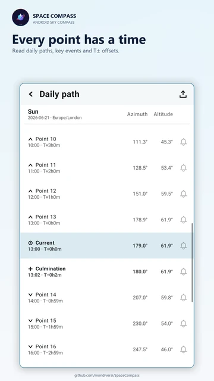</a> 
      Daily path
    </td>
    <td align="center">
      <a href="full/05-catalogue-portrait.webp">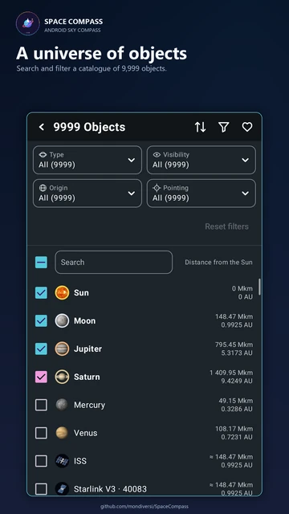</a> 
      Catalogue and filters
    </td>
    <td align="center">
      <a href="full/06-location-portrait.webp">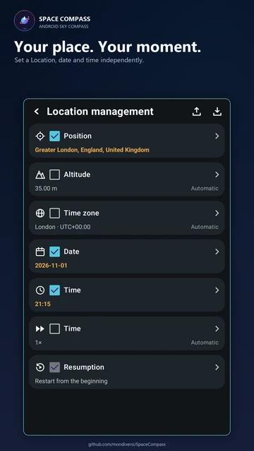</a> 
      Location management
    </td>
  </tr>
  <tr>
    <td align="center">
      <a href="full/07-key-heights-portrait.webp">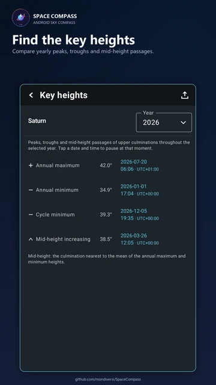</a> 
      Key heights
    </td>
    <td align="center">
      <a href="full/08-key-events-portrait.webp">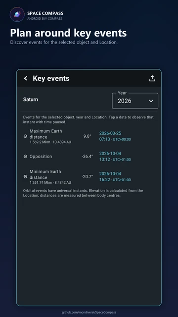</a> 
      Key events
    </td>
    <td align="center">
      <a href="full/12-export-portrait.webp">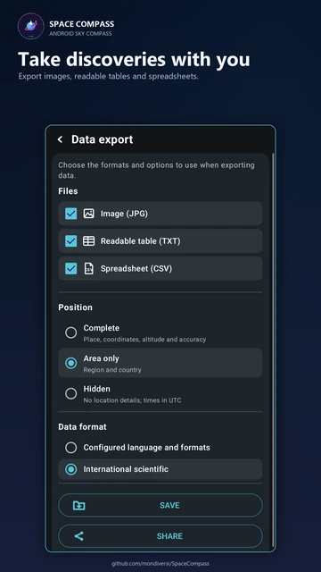</a> 
      Data export
    </td>
  </tr>
  <tr>
    <td align="center">
      <a href="full/13-general-portrait.webp">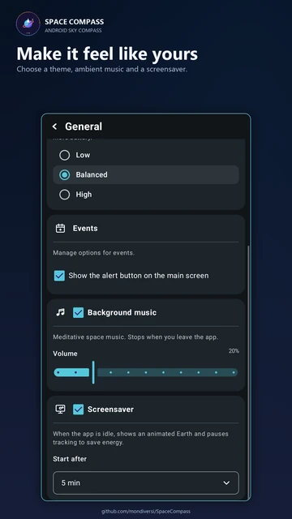</a> 
      General settings
    </td>
    <td align="center">
      <a href="full/15-globe-day-portrait.webp">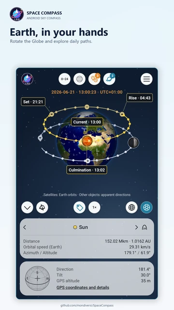</a> 
      Interactive Globe
    </td>
    <td align="center">
      <a href="full/16-globe-labels-portrait.webp">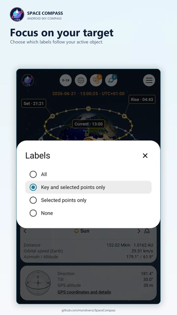</a> 
      Globe label options
    </td>
  </tr>
  <tr>
    <td align="center">
      <a href="full/17-tutorial-globe-portrait.webp">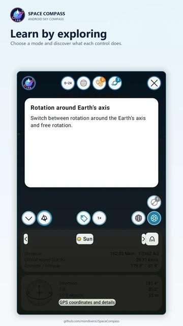</a> 
      Interactive tutorial
    </td>
  </tr>
</table>

## Landscape

<table>
  <tr>
    <td align="center">
      <a href="full/09-observatory-landscape.webp">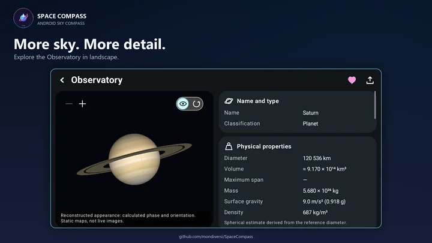</a> 
      Landscape Observatory
    </td>
    <td align="center">
      <a href="full/10-sunrise-landscape.webp">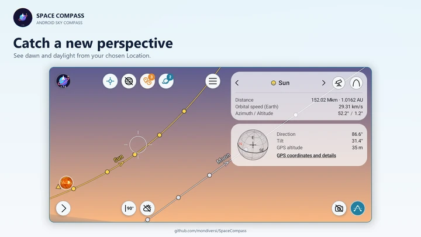</a> 
      Dawn in landscape
    </td>
  </tr>
  <tr>
    <td align="center">
      <a href="full/11-panorama-landscape.webp">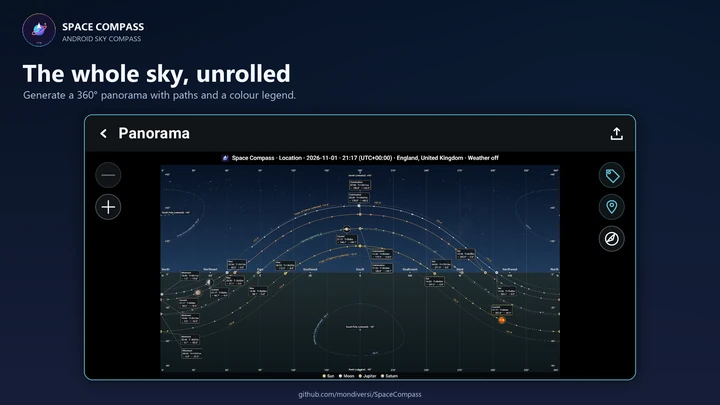</a> 
      Full-sky panorama
    </td>
    <td align="center">
      <a href="full/14-daily-path-landscape.webp">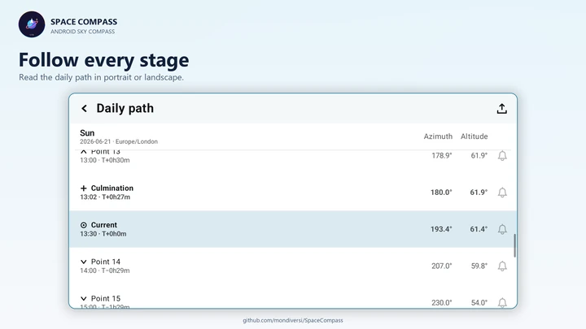</a> 
      Landscape daily path
    </td>
  </tr>
  <tr>
    <td align="center">
      <a href="full/18-globe-night-landscape.webp">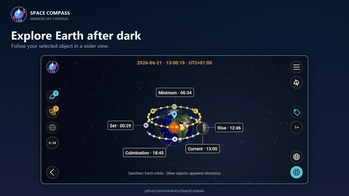</a> 
      Globe in landscape
    </td>
    <td align="center">
      <a href="full/19-globe-capture-landscape.webp">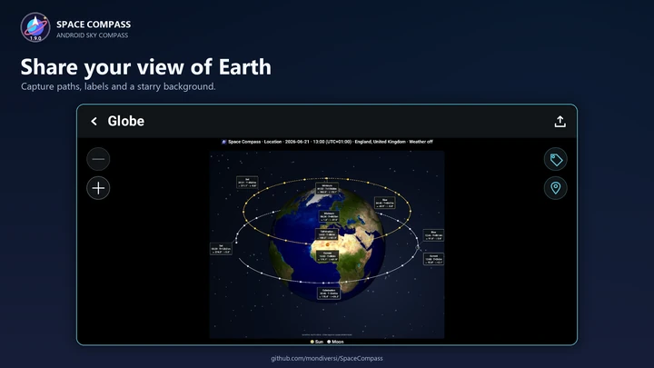</a> 
      Landscape Globe capture
    </td>
  </tr>
  <tr>
    <td align="center">
      <a href="full/20-view-modes-landscape.webp">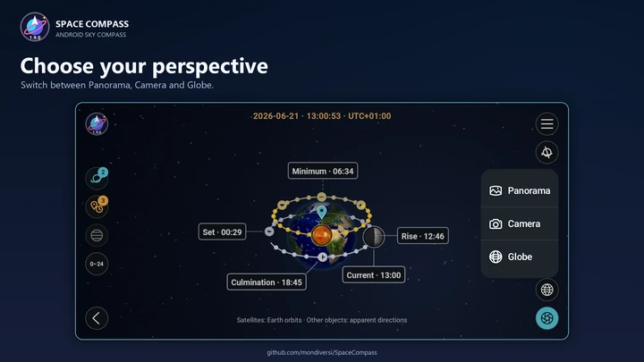</a> 
      Three viewing modes
    </td>
  </tr>
</table>

## Unframed app screenshots

The presentation cards add an English heading and a decorative frame around genuine app screenshots. The app content has not been rewritten. Android status and navigation bars are cropped out.

- [Daylight sky](raw/01-day-sky-portrait.webp)
- [Night sky](raw/02-night-sky-portrait.webp)
- [Saturn Observatory](raw/03-observatory-portrait.webp)
- [Daily path](raw/04-daily-path-portrait.webp)
- [Catalogue and filters](raw/05-catalogue-portrait.webp)
- [Location management](raw/06-location-portrait.webp)
- [Key heights](raw/07-key-heights-portrait.webp)
- [Key events](raw/08-key-events-portrait.webp)
- [Landscape Observatory](raw/09-observatory-landscape.webp)
- [Dawn in landscape](raw/10-sunrise-landscape.webp)
- [Full-sky panorama](raw/11-panorama-landscape.webp)
- [Data export](raw/12-export-portrait.webp)
- [General settings](raw/13-general-portrait.webp)
- [Landscape daily path](raw/14-daily-path-landscape.webp)
- [Interactive Globe](raw/15-globe-day-portrait.webp)
- [Globe label options](raw/16-globe-labels-portrait.webp)
- [Interactive tutorial](raw/17-tutorial-globe-portrait.webp)
- [Globe in landscape](raw/18-globe-night-landscape.webp)
- [Landscape Globe capture](raw/19-globe-capture-landscape.webp)
- [Three viewing modes](raw/20-view-modes-landscape.webp)

## Capture information

- **Language:** English, with metric units.
- **Location:** a public London, United Kingdom demonstration. No personal location, account information, notifications or private camera images were used.
- **Environment:** an isolated Android 15 emulator, with portrait and landscape layouts, light and dark themes, and illustrative dates and times.
- **Build:** Space Compass 1.7.6 and 1.9.0. The interface was captured from the matching debug build; the published APK uses the distribution signature.
- **Dimensions:** 1080 × 1920 for portrait cards; 1920 × 1080 for landscape cards. Full-size cards and unframed captures use lossless WebP; the README uses smaller WebP previews.
- **Astronomy:** planetary appearances are reconstructed by the app from maps and calculated viewing geometry. Dates, paths, heights and events are examples for the selected Location and moment.

The app logo and interface belong to Space Compass. Scientific imagery retains the attribution and license information in [Asset credits](../../ASSET_CREDITS.md). See also the repository [license](../../LICENSE).

File dimensions and full-size card SHA-256 checksums are recorded in [manifest.json](manifest.json).

The Globe presents Earth-centred satellite tracks and apparent directions for distant objects. Its decorative background stars are not a measured star chart.
